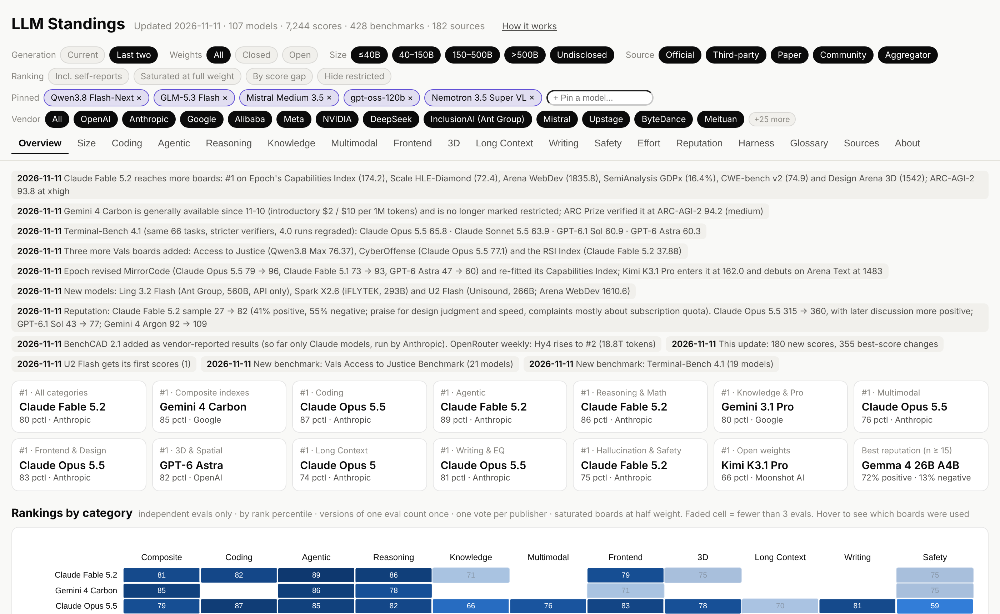

[](https://acrab-agentic-labs.github.io/llm-standings/)

# LLM Standings

**The leaderboard of leaderboards, built from independent evaluations.**
How close is a 100B open model to the frontier? Updated daily.

**[Live leaderboard →](https://acrab-agentic-labs.github.io/llm-standings/)**

<!-- badges:start -->
     
<!-- badges:end -->

---

Every lab publishes its own benchmark table, and every leaderboard measures something slightly different. LLM Standings
collects results from independent leaderboards, papers and vendor reports, keeps a source link for every number, and
combines them into one ranking per category. It is updated every day.

We built it to answer a practical question for on-device agents: which open model in the ~100B class should you run,
and how much do you give up compared with the closed frontier?

## What makes it different

- **Independent results first.** Rankings use third-party and community evaluations by default. Vendor self-reports are shown on every chart but count only if you switch them on.
- **One publisher, one vote.** A site that runs ten evals gets the same weight as a site that runs one, so no single publisher decides the ranking.
- **Thin evidence can't top the list.** A model's score is pulled toward the middle when it has been measured on only a few benchmark families.
- **Effort and harness are kept apart.** The same model at `low` and `max` reasoning effort, or in Claude Code versus mini-swe-agent, is recorded separately. On the same benchmark, the harness alone typically moves a score by about 5 points, and by more than 10 in some agentic-coding results.

The full method, including how saturated and stale benchmarks are handled, is in [METHODOLOGY.md](METHODOLOGY.md).

## Snapshot

Overall percentile across categories, independent results only. As of **2026-11-11**; see the [live leaderboard](https://acrab-agentic-labs.github.io/llm-standings/) for today's numbers.

| | Model | Size | Overall | Rank | Evidence |
|---|---|---|---:|---:|---|
| Closed frontier | Claude Fable 5.2 | undisclosed | 79.9 | 1 / 85 | 41 evals · 8 categories |
| Best open model | Kimi K3.1 Pro | 2.8T, 104B active | 65.5 | 12 / 85 | 43 evals · 10 categories |
| Best open, 40–150B | Qwen3.8 Flash-Next | 125B, 6B active | 55.7 | 24 / 85 | 8 evals · 3 categories |

Claude Fable 5.2 was released on Nov 9 and has results in 8 of 11 categories so far. Rank 2 is Gemini 4 Carbon (78.8, 5 categories), generally available since Nov 10. Claude Opus 5.5 (76.8, rank 3, 63 evals across all 11 categories) is the closed model with the broadest coverage.

## Using the data

Everything shown on the page is in [`data.json`](data.json). Each score row records the model, benchmark, value, reasoning effort, harness, source type, date and source URL.

```python
import json, urllib.request
data = json.load(urllib.request.urlopen("https://acrab-agentic-labs.github.io/llm-standings/data.json"))
print(len(data["models"]), "models,", len(data["scores"]), "scores")
```

The raw tables (models, benchmarks, sources, scores) are under [`data/`](data/).

## Corrections

If a number is wrong or a source is missing, please [open an issue](https://github.com/Acrab-Agentic-Labs/llm-standings/issues/new/choose). We use two templates: **Wrong score** and **Add a source or model**. Accepted corrections are logged in [`data/corrections.json`](data/corrections.json) and shown on the leaderboard's *About* tab.

## Running it yourself

[`llm_bench.py`](llm_bench.py) uses only the Python standard library and calls Claude to read and extract leaderboard pages. A full update takes 15–25 minutes. See [docs/UPDATING.md](docs/UPDATING.md) for setup, commands and configuration.

## Citation

```bibtex
@misc{llmstandings2026,
  title  = {LLM Standings: A Daily Leaderboard of Leaderboards},
  author = {Zhang, Yiran and {Acrab Research}},
  year   = {2026},
  url    = {https://github.com/Acrab-Agentic-Labs/llm-standings}
}
```

## Contact

LLM Standings is maintained by Yiran Zhang at [Acrab AI](https://acrab.ai). For data issues, please open an issue; for anything else, write to [yiran.zhang@acrab.ai](mailto:yiran.zhang@acrab.ai).

## License

Code is released under the [MIT License](LICENSE). Curated data in [`data/`](data/) is released under [CC BY 4.0](data/LICENSE). Individual scores remain subject to the terms of their original sources, which are linked from every data point. The bundled [ECharts](https://echarts.apache.org) library is Apache-2.0 (see [NOTICE](NOTICE)).
